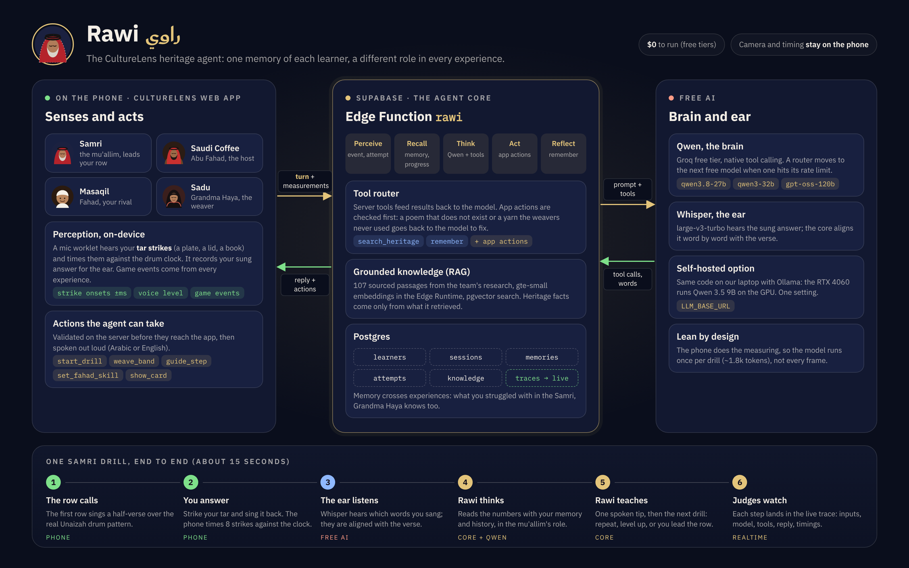

# Rawi, the CultureLens heritage agent

One agent with one memory of each learner, taking a role in every experience: the mu'allim in the Samri,
Abu Fahad in the coffee majlis, Fahad across the Masaqil square, Grandma Haya at the Sadu loom.
It runs as one Supabase Edge Function (`functions/rawi`) and costs nothing on free tiers.

## How a turn works

1. **Perceive**: the phone sends what happened: a game event, a measured attempt (Samri strikes timed by an
   AudioWorklet against the drum clock, plus the sung answer as audio), or something the learner said.
2. **Hear**: a sung or spoken answer goes to Whisper (large-v3-turbo, free on Groq); the transcript is aligned
   word by word with the expected verse after Arabic normalization (`arabic.ts`).
3. **Recall**: the learner's memories (from every experience) and recent attempts go into the prompt.
4. **Think and act**: Qwen (free on Groq; a router falls back to the next free model on a rate limit) answers
   in the experience's role and calls tools. Server tools run in the function (`search_heritage` over pgvector,
   `remember`). App tools (`start_drill`, `weave_band`, `guide_step`, `set_fahad_skill`, `show_card`) are
   validated, then sent to the phone; a wrong call goes back to the model as an error to fix.
5. **Reply**: one or two spoken sentences, read out on the phone in Arabic or English.
6. **Trace**: every step is written to `traces`; `rawi-judge.html` streams them live (Supabase Realtime).

Heritage facts come only from `knowledge`: the 107 passages the team wrote and sourced in the experiences,
embedded by the function itself with gte-small (built into the Edge Runtime).

## Set up (about 5 minutes)

1. Create a Supabase project (free).
2. Run both files in `migrations/` (SQL editor, or `supabase db push`).
3. Deploy the function: `supabase functions deploy rawi --no-verify-jwt`
   (the function is public like the app; it limits each device and each day itself).
4. Secrets (Dashboard > Edge Functions > Secrets):
   - `GROQ_API_KEY`: free at console.groq.com
   - optional `LLM_BASE_URL` and `LLM_MODELS` to use another OpenAI-compatible brain, for example Ollama on
     our own laptop: `LLM_BASE_URL=https://<tunnel>/v1`, `LLM_MODELS=qwen3.5:9b`
5. Put the project URL and its anon (publishable) key in `rawi-config.js` at the root of the app.

## Files

| file | what it does |
|---|---|
| `functions/rawi/index.ts` | the HTTP entry: turn, health, seed |
| `functions/rawi/agent.ts` | one agent turn: perceive, hear, recall, think with tools, reply, trace |
| `functions/rawi/personas.ts` | who Rawi is in each experience, its playbook and its tools |
| `functions/rawi/tools.ts` | the tools and their checks |
| `functions/rawi/llm.ts` | the model router and the ear (Whisper) |
| `functions/rawi/arabic.ts` | Arabic normalization, word alignment, word timing |
| `functions/rawi/store.ts` | Postgres access and the self-filling embeddings |
| `functions/rawi/knowledge.ts` | the heritage passages |

On the phone: `rawi.js` (the agent's face on every experience page), `samri-perform.js` (perform the Samri in
the row), the event hooks in `qahwa.js`, `masaqeel.js` and `sadu.js`, and `rawi-judge.html` (the live trace).
